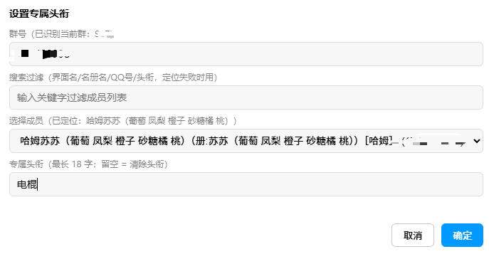
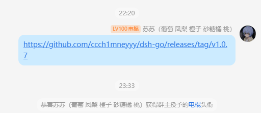

# qq-pc-special-title — QQ PC 端群成员专属头衔一键设置

在 QQ 群成员列表右键菜单中，一键设置/清除群成员专属头衔的 LiteLoaderQQNT 插件，
通过 NapCat Framework 的 OneBot HTTP API 调用 `set_group_special_title`。

- 环境：Windows QQ（x64），Electron 40
- 状态：端到端验证通过（右键菜单 → 选成员 → 头衔真实生效）

## 背景与动机

QQ 的"专属头衔"（群荣誉）修改入口极其隐蔽：

- **PC 端**：目前没有修改头衔的入口，只能查看
- **移动端**：需要约 7 步操作（进入群聊 → 群设置 → 更多 → 群荣誉 → … → 选成员 → 填头衔 → 确认），每次设置一个成员都要重复一遍

本插件把整个过程压缩为 **一次右键**：群成员列表右键成员 → 「设置专属头衔」→ 选成员、填头衔 → 确定。
群号自动记忆，成员下拉自动拉取，头衔留空提交即清除。

## 效果图

设置弹窗（已按右键成员自动定位）：



设置后系统提示头衔生效：



## 功能

- 群成员列表右键 → 「设置专属头衔」→ 选成员、填头衔 → 确定
- 群号首次填写后记住（localStorage）
- 成员下拉自动拉取群成员列表，显示「昵称［当前头衔］(QQ号)」
- 头衔留空提交 = 清除头衔
- 智能预选：按右键成员的显示名自动定位目标成员（见「匹配算法」）

## 架构

```
QQ（日常客户端，登录你的账号）
├── LiteLoaderQQNT（改 package.json 入口 + QQNT.dll 校验补丁加载）
│   └── QuickSpecialTitle 插件（右键菜单 + 成员选择弹窗）
└── NapCat Framework（运行时注入，零文件侵入）
    └── OneBot HTTP API → 127.0.0.1:3000（set_group_special_title）
```

一次登录同时提供聊天界面与 API 后端，无重复登录冲突。

## 安装

1. **安装 NapCat Framework**（最新版），配置 onebot11 HTTP 监听 `127.0.0.1:3000`，
   记下其中的 token。
2. **安装 LiteLoaderQQNT**（v1.4.1 为最终版本），并把本仓库
   `plugin/QuickSpecialTitle/` 复制到 `<QQ安装目录>\resources\app\LiteLoaderQQNT\plugins\`。
3. **注入 API Token**：启动 QQ 前设置环境变量 `NAPCAT_API_TOKEN=<你的 OneBot token>`
   （与 NapCat onebot11 配置一致）。若 NapCat 未开启鉴权可留空。
4. 按下方「LiteLoader 兼容补丁」处理 QQ 内置 Electron 40 的兼容问题后，重启 QQ。

### LiteLoader 兼容补丁（Electron 40）

官方 LiteLoaderQQNT 1.4.1 不支持 QQ 新版本内置的 Electron 40，需要四处兼容补丁：

1. **QQNT.dll 校验补丁**：`package.json` 修改后绕过启动器完整性校验（QQNTPatcher 一类工具，5 字节差异）。
2. **`src/main/store.js`**：`dirent.path` → `LiteLoader.path.plugins`（Node 版本 API 差异）。
3. **`src/main/hook.js` + `src/preload/bootstrap_N.cjs`**：新版 QQ 全窗口 `sandbox:true`，
   构造时强制 `sandbox:false`，并用每窗口独立引导文件串联「LiteLoader api.js → module.js → QQ 原生 preload」。
4. **`src/preload/module.js`**：Electron 40 中各 preload 的 `module` 不再共享，
   改用 `LL_API_RESULT`（直接经 IPC 获取 LiteLoader 元数据）。

QQ 自动更新后上述文件可能被还原，需按此重做。

## 使用

1. 双击 NapCat 启动脚本启动 QQ（直接点 QQ 图标也可用，但没有 API 后端，右键设置头衔会报连接失败）。
2. 群成员列表右键成员 → 「设置专属头衔」→ 选成员、填头衔 → 确定。
3. NapCat WebUI（可选）：`http://127.0.0.1:6099/webui`，token 见 NapCat `config/webui.json`。

## 匹配算法

打开弹窗时拉取最近 50 条消息历史，以**消息正文**为钥匙对齐 DOM 消息与 API 消息
（正文与名字缓存无关，绝对可靠），反推「界面新名字 → QQ号」映射，作为名册之外的第一优先匹配源。
下拉同时显示「界面名（册:名册名）」，识别与人工选择都可用。

匹配器策略（按优先级）：

1. 界面新名（消息对齐）+ 名册变体（原名 / 头衔+原名 / 身份+原名）
2. 精确匹配任意长度（单字名安全）；模糊匹配要求名字 ≥2 字
3. 四个方向：精确 / 前缀 / 名字⊃字段 / 字段⊃名字（头衔前缀）
4. 全半角折叠（`（）() 、【】[] 、＿_ 、—-`）
5. 子串匹配约束：字段作为名字完整子串时必须足够长且占比较大，防单字短昵称大面积误配
6. 命不中 → 占位提示手动选择，绝不冒充

回复引用消息：右键时爬到最外层消息容器取真正发送者，不抓被引用者。

## 已知限制

**QQ 多级缓存脑裂**：渲染层（界面/消息头）显示的名字是成员最新的昵称/名片，但 QQ 内核
名册、`stranger_info`、消息历史接口全部滞后（`no_cache` 也无效），面板名对不上名册 → 识别失败。

对策：消息文本对齐反推（见上）。仍识别不出的场景：成员从未在最近 50 条消息里发言且名册滞后 →
手动下拉（下拉已带界面名与 QQ 号），等 QQ 缓存自然同步或点开其资料卡后恢复。

## 测试

```bash
node tests/test-match.js   # 预选匹配逻辑单测（夹具为虚构数据，保留真实名字形态）
```

## 诊断工具

插件 main.cjs 内置本地探针通道（文件触发，仅本机使用）：

- 向 `probe-command.json` 写入 `{"urlIncludes":"<url关键字>","code":"(function(){...})()"}`
- 结果回写到 `probe-result.json`（支持 `"all":true` 遍历所有窗口）
- 通道路径可通过环境变量 `QUICK_TITLE_PROBE_CMD` / `QUICK_TITLE_PROBE_RESULT` 覆盖

```bash
node tools/probe-client.js tools/probe-example.js [urlIncludes]
```

## 安全说明

- OneBot HTTP 只监听 `127.0.0.1:3000`，token 经环境变量注入（不在代码中硬编码）
- 插件对渲染层开放的 API 为只读白名单：`get_group_member_list` / `get_group_info` /
  `get_group_member_info` / `get_group_msg_history` / `get_group_list`
- NapCat WebUI 默认监听 `0.0.0.0:6099`（Framework 默认），如需收紧可在 `webui.json` 配置
- 专属头衔仅**群主**账号可设置；API 账号只在它是群主的群有效

## 回滚

- 恢复原版 QQ：把备份的原版 `QQNT.dll` 复制回 `<QQ安装目录>\QQNT.dll`，
  原版 `package.json` 复制回 `<QQ安装目录>\resources\app\package.json`（QQ 未运行时操作）
- NapCat 无需卸载（未写入任何 QQ 文件），删除其安装目录即可
- LiteLoader：删除 `resources\app\LiteLoaderQQNT\` 与 `resources\app\app_launcher\` 目录

## 目录结构

```
plugin/QuickSpecialTitle/   插件源码（manifest / main / preload / renderer）
tests/                      匹配逻辑单测
tools/                      API 冒烟脚本、探针客户端与示例
```

## 版本兼容备忘

- NapCat v4.18.41：发布说明 v4.18.35+ 明确适配 QQ 9.9.36-53644
- LiteLoaderQQNT 官方仓库 2026-05 归档，最终版本 1.4.1
